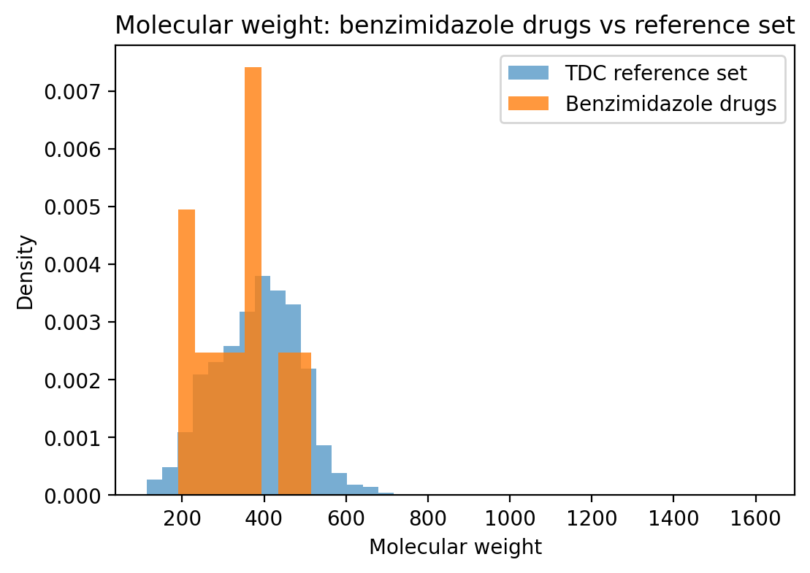
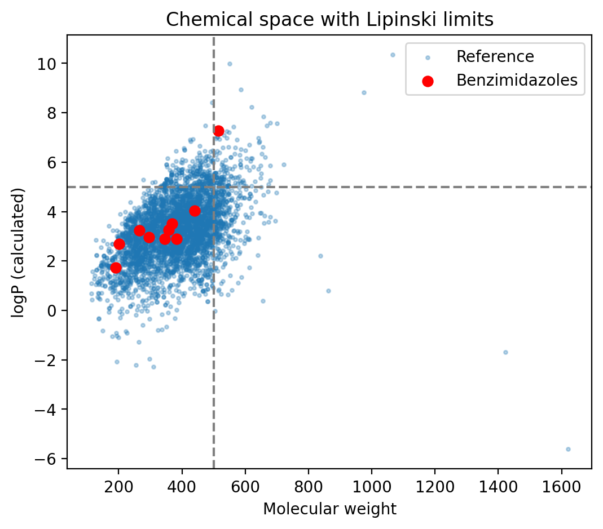
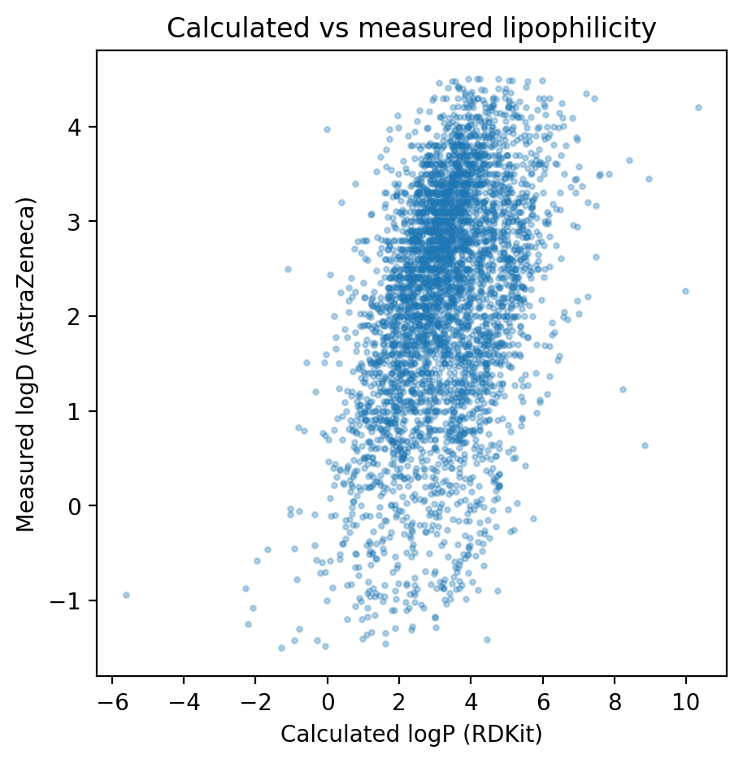

# Drug-likeness of benzimidazole drugs

What makes a molecule drug-like? Benzimidazole is a ring that turns up again and again in real medicines, from antiparasitic drugs to heart and stomach treatments. After writing a literature review on its chemistry and therapeutic uses, I wanted to look at it from a data angle.

So I pulled ten benzimidazole drugs from PubChem, calculated their properties with RDKit, and checked them against Lipinski's rule of five. Then I compared them with a larger set of 4,200 drug-like molecules to see where they sit. It is a small first step into cheminformatics, built entirely with free tools in Google Colab.

## Question
Do ten well-known benzimidazole drugs fall within Lipinski's rule of five, and how do their properties compare with a larger set of drug-like molecules?

## Data (all free)
- **Ten benzimidazole drugs:** albendazole, mebendazole, thiabendazole, omeprazole, pantoprazole, lansoprazole, carbendazim, telmisartan, candesartan, bendamustine. Structures were retrieved from PubChem using PubChemPy.
- **Reference set:** 4,200 molecules from the MoleculeNet Lipophilicity dataset (AstraZeneca).

## Methods
Molecular weight, calculated logP, hydrogen bond donors and acceptors, TPSA and rotatable bonds were calculated with RDKit in Google Colab. Rule of five violations were counted for each compound.

## Results
- 9 of the 10 benzimidazole drugs have no rule-of-five violations. Telmisartan has 2 (molecular weight 514.6 and calculated logP 7.26).
- 81.9% of the reference set has no violations.
- Median molecular weight: 351.8 (benzimidazoles) vs 388.4 (reference). Median logP: 3.11 vs 3.28.
- Calculated logP and measured logD correlate at 0.42 across the reference set.

## What I take from this
The benzimidazole drugs sit in much the same range as the larger set, a little smaller and a little less lipophilic on average. Telmisartan is the one that breaks the rule, which is a good reminder that the rule of five is a guideline and not a law. With only ten drugs, I would not claim a real difference from the reference set.

## Limits
- Only ten drugs, so this shows examples and not a statistical result.
- The rule of five is meant for oral drugs, and bendamustine is given by injection.
- RDKit logP is a calculated estimate, while the reference set measures logD, so they are not the same quantity.

## Files
- `benzimidazole_druglikeness.ipynb`: the full analysis
- `benzimidazole_properties.csv`: calculated properties
- `mw_plot.png`, `mw_logp.png`, `logp_vs_logd.png`: plots

## Tools
Python, RDKit, pandas, matplotlib, PubChemPy, Google Colab.
